# Party Planer – Code-Dokumentation

Diese Dokumentation erklärt, **was im gesamten Projekt passiert und warum**: von der Docker-Infrastruktur über jede Backend-Klasse
bis zu jeder Frontend-Komponente. Die Diagramme sind in [Mermaid](https://mermaid.js.org/) geschrieben und werden von GitHub
direkt gerendert.

> Stand: entspricht dem Branch `release` (Spring Boot 4.1, Java 21, Next.js 16, React 19, PostgreSQL 17).
> Kurzanleitung zum Starten steht in der [README](README.md); hier geht es um das Verständnis des Codes.

## Inhaltsverzeichnis

1. [Was ist der Party Planer?](#1-was-ist-der-party-planer)
2. [Architektur im Überblick](#2-architektur-im-überblick)
3. [Repository-Struktur](#3-repository-struktur)
4. [Betrieb: Docker, Konfiguration, CI/CD](#4-betrieb-docker-konfiguration-cicd)
5. [Backend (Spring Boot)](#5-backend-spring-boot)
   - [5.1 Start und Konfiguration](#51-start-und-konfiguration)
   - [5.2 Paketübersicht](#52-paketübersicht)
   - [5.3 Datenmodell und Migrationen](#53-datenmodell-und-migrationen)
   - [5.4 Sicherheit im Detail](#54-sicherheit-im-detail)
   - [5.5 Ablaufdiagramme](#55-ablaufdiagramme)
   - [5.6 API-Referenz](#56-api-referenz)
   - [5.7 Die Pakete einzeln](#57-die-pakete-einzeln)
   - [5.8 Fehlerbehandlung und Fehlercodes](#58-fehlerbehandlung-und-fehlercodes)
   - [5.9 Audit-Log (Verlauf)](#59-audit-log-verlauf)
   - [5.10 Logging](#510-logging)
   - [5.11 Geplante Jobs](#511-geplante-jobs)
6. [Frontend (Next.js)](#6-frontend-nextjs)
   - [6.1 Aufbau und Routen](#61-aufbau-und-routen)
   - [6.2 Konfiguration (`next.config.ts`)](#62-konfiguration-nextconfigts)
   - [6.3 Bibliothek `src/lib`](#63-bibliothek-srclib)
   - [6.4 Internationalisierung und Theme](#64-internationalisierung-und-theme)
   - [6.5 Komponenten](#65-komponenten)
   - [6.6 Wichtige Abläufe im Frontend](#66-wichtige-abläufe-im-frontend)
7. [Tests und Qualitätssicherung](#7-tests-und-qualitätssicherung)
8. [Sicherheitskonzept in einer Tabelle](#8-sicherheitskonzept-in-einer-tabelle)
9. [Fehlersuche (Troubleshooting)](#9-fehlersuche-troubleshooting)
10. [Glossar](#10-glossar)

---

## 1. Was ist der Party Planer?

Mit dem Party Planer plant man **Veranstaltungsorte („Places“)** auf einem **Grundriss** (Bild) und platziert darauf
**Equipment** (z. B. Lichtstative oder beliebige Gegenstände mit Foto) als nummerierte, farbige **Marker**.

Die wichtigsten Konzepte:

| Begriff | Bedeutung |
|---|---|
| **Folder (Ordner)** | Gruppiert Places. Jeder Place liegt in genau einem Ordner. |
| **Place (Ort)** | Name + Grundriss-Bild + Marker. |
| **Placement / Marker** | Punkt auf dem Grundriss (Position relativ 0–1), Farbe, optional zugewiesenes Equipment. Die Reihenfolge bestimmt die angezeigte Nummer. |
| **Equipment** | Kategorie `STAND` (Lichtstativ, zusammengesetzt aus bis zu 9 Teilbildern) oder `OTHER` (ein Foto). |
| **Image** | Hochgeladenes PNG/JPEG/WebP. Bytes liegen als Datei auf der Platte, die DB kennt nur Metadaten. |
| **User / Rolle** | `USER` oder `ADMIN`. Der erste registrierte Account ist automatisch Admin. |
| **Invitation (Einladung)** | Einmal-Link, mit dem Admins Personen einen Account anlegen lassen – auch bei geschlossener Registrierung. |
| **Share-Link** | Widerrufbarer Link auf **einen** Place. Besucher werden **Gäste** (nur Lesezugriff, kein Account). |
| **Audit-Log** | Dauerhafter Verlauf: wer hat wann was wo und wie geändert. |

Daten sind strikt **pro Besitzer** getrennt: fremde Datensätze antworten mit `404`.

---

## 2. Architektur im Überblick

Der Browser spricht **nur** mit dem Next.js-Server. Dieser reicht alles unter `/api/*` per Rewrite an das Spring-Boot-Backend
weiter. Dadurch ist alles *same-origin*: kein CORS, und die `SameSite=Strict`-Cookies funktionieren.

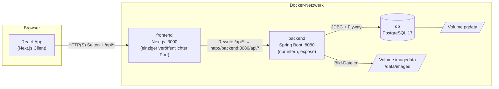

**Warum ist das Backend nicht veröffentlicht?** Das Backend vertraut `X-Forwarded-For` (für Rate-Limiting und IP im Audit-Log).
Wäre es direkt erreichbar, könnte jeder diesen Header fälschen.

### Schichten im Backend

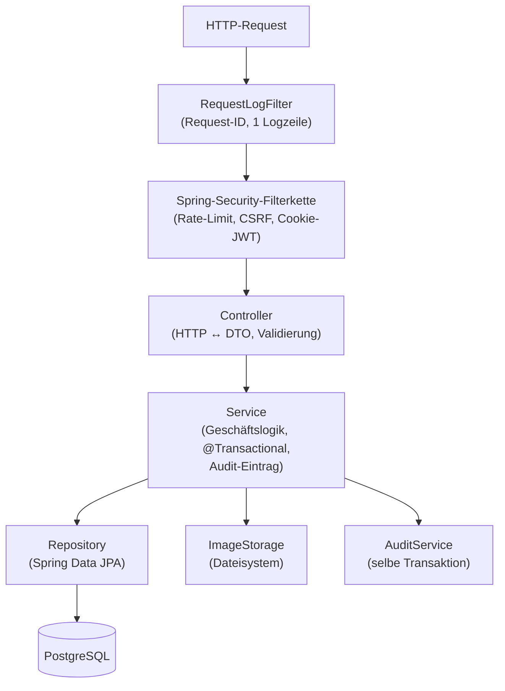

Konvention: Controller sind dünn, **Services enthalten die Logik**, Repositories sind (fast) immer auf den Besitzer eingeschränkt
(`findByIdAndOwnerId`).

---

## 3. Repository-Struktur

```text
party-planer/
├── docker-compose.yml        Gesamter Stack (db, backend, frontend) – baut oder zieht Images
├── .env.example              Vorlage für .env (Passwörter, JWT-Secret, Ports)
├── README.md                 Kurzanleitung
├── DOCUMENTATION.md          Diese Datei
├── AGENTS.md                 Arbeitsanleitung für KI-Agenten (CLAUDE.md / GEMINI.md binden sie ein)
├── .github/
│   ├── workflows/ci.yml      Tests, Lint, Build, Docker-Smoke-Test
│   ├── workflows/docker.yml  Veröffentlicht Images nach GHCR (nur bei grünem CI)
│   └── dependabot.yml        Wöchentliche Updates (Maven, npm, Docker, Actions)
├── backend/                  Spring Boot API
│   ├── Dockerfile            Mehrstufig: JDK-Build → JRE-Runtime
│   ├── pom.xml
│   └── src/
│       ├── main/java/app/partyplaner/…     Anwendungscode (je Paket ein Fachbereich)
│       ├── main/resources/application*.yml Konfiguration
│       ├── main/resources/db/migration/    Flyway-Migrationen V1–V4
│       └── test/…                          Unit- und Integrationstests
└── frontend/                 Next.js-App
    ├── Dockerfile            Mehrstufig: deps → build → schlanke Runtime (standalone)
    ├── next.config.ts        Proxy /api, Sicherheits-Header (CSP), i18n-Plugin
    └── src/
        ├── app/              Routen (App Router) + globales CSS (Theme)
        ├── components/       UI-Komponenten, nach Fachbereich gruppiert
        ├── lib/              API-Client, Queries, Logger, Typen, Helfer
        ├── i18n/             Sprachwahl (Cookie) und next-intl-Konfiguration
        ├── messages/         de.json / en.json (alle Texte)
        └── test/             Test-Helfer und Mocks
```

---

## 4. Betrieb: Docker, Konfiguration, CI/CD

### 4.1 Die drei Services (`docker-compose.yml`)

| Service | Image | Aufgabe | Besonderheiten |
|---|---|---|---|
| `db` | `postgres:17-alpine` | Datenbank | Volume `pgdata`; Healthcheck `pg_isready`; Port nur an `127.0.0.1` gebunden (für lokale Entwicklung). |
| `backend` | `ghcr.io/…/party-planer-backend` (oder lokal gebaut) | REST-API | Wartet auf gesunde DB; Volume `imagedata` → `/data/images`; Port **nicht** veröffentlicht. |
| `frontend` | `ghcr.io/…/party-planer-frontend` (oder lokal gebaut) | Web-App + `/api`-Proxy | Wartet auf gesundes Backend; veröffentlicht `${FRONTEND_PORT:-3000}`. |

Gemeinsame Härtung (YAML-Anker `x-hardening`): `restart: unless-stopped`, `no-new-privileges`, `cap_drop: ALL` (außer bei Postgres,
das einige Capabilities zum Starten braucht).

Start-Reihenfolge:

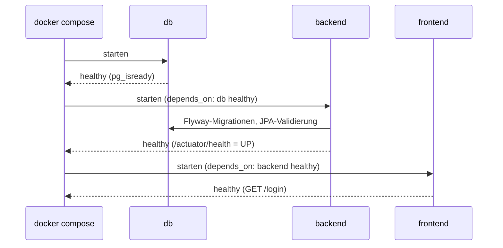

### 4.2 Umgebungsvariablen

| Variable | Pflicht | Standard | Wirkung |
|---|---|---|---|
| `POSTGRES_PASSWORD` | ja | – | Passwort der DB; Compose bricht ohne Wert ab. |
| `JWT_SECRET` | ja | – | Signiert die Access-Tokens (HS256). **Mindestens 32 Zeichen**, sonst startet das Backend nicht (`@Size(min = 32)`). Erzeugen: `openssl rand -base64 48`. |
| `POSTGRES_DB` / `POSTGRES_USER` | nein | `partyplaner` | Datenbankname und -benutzer. |
| `COOKIE_SECURE` | nein | `true` | `Secure`-Flag aller Cookies. Über **HTTP** muss es `false` sein, sonst verwirft der Browser die Cookies (→ „bitte anmelden“). Hinter HTTPS immer `true`. |
| `REGISTRATION_ENABLED` | nein | `true` | Startwert für „Registrierung offen“. Der Admin kann das zur Laufzeit in den Einstellungen ändern (der DB-Wert gewinnt dann). |
| `FRONTEND_PORT` | nein | `3000` | Host-Port der Web-App. |
| `POSTGRES_PORT` | nein | `5432` | Host-Port der DB (nur `127.0.0.1`). |
| `REGISTRY` / `IMAGE_TAG` | nein | `ghcr.io/samuelthomas08` / `latest` | Woher `docker compose pull` die Images holt. |
| `IMAGE_DIR` | nein | `/data/images` (Docker) / `./data/images` (lokal) | Ablageort der Bilddateien (im Compose fest auf das Volume gesetzt). |
| `DB_URL`, `DB_USER`, `DB_PASSWORD` | – | von Compose gesetzt | Verbindung des Backends zur DB. |
| `BACKEND_URL` | – | `http://backend:8080` | **Build-Argument** des Frontends (siehe unten). |

### 4.3 Dockerfiles

**`backend/Dockerfile`** (mehrstufig)

1. *Build-Stage* (`eclipse-temurin:21-jdk`): erst `pom.xml` + Wrapper kopieren und `dependency:go-offline` ausführen (Docker-Cache →
   Abhängigkeiten werden nicht bei jeder Code-Änderung neu geladen), dann Quellcode kopieren und `package -DskipTests`.
2. *Runtime* (`eclipse-temurin:21-jre-alpine`): unprivilegierter Benutzer `app` (UID 10001), Verzeichnis `/data/images` als Volume,
   Healthcheck gegen `/actuator/health`, Start mit `-XX:MaxRAMPercentage=75` (JVM nutzt bis 75 % des Container-RAMs).

**`frontend/Dockerfile`** (mehrstufig)

1. *deps*: `npm ci` mit Cache-Mount.
2. *build*: `npm run build`. **Wichtig:** Next.js „backt“ die Rewrites beim Build ein, daher ist `BACKEND_URL` ein *Build-Argument*
   (Standard `http://backend:8080`). Deshalb muss der Compose-Service `backend` heißen.
3. *Runtime*: nur das `standalone`-Bundle (`node server.js`), Benutzer `app`, Healthcheck `GET /login`.

### 4.4 CI/CD (`.github/workflows`)

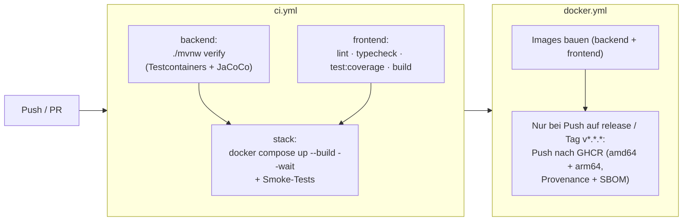

* **`ci.yml`** läuft bei jedem Push auf `release`, bei jedem PR und wird von `docker.yml` wiederverwendet (`workflow_call`).
  Der **Smoke-Test** startet den echten Stack, prüft, dass `/login` antwortet, `/api/auth/csrf` erreichbar ist, `/api/folders`
  ohne Login `401` liefert, das Backend **nicht** direkt auf Port 8080 erreichbar ist, und registriert einen Benutzer, lädt ein
  Bild hoch und prüft, dass genau eine Datei im Volume liegt.
* **`docker.yml`** baut beide Images. Pull Requests bauen nur (amd64, kein Push). Pushes auf `release` und Version-Tags führen
  zuerst die Tests aus und pushen dann nach GHCR. Tags: `latest` (Default-Branch), Branch/PR-Name, `1.2.3`, `1.2`, `sha-<kurz>`.
* **Dependabot** hält Maven, npm, beide Dockerfiles und die GitHub Actions wöchentlich aktuell.

---

## 5. Backend (Spring Boot)

Basis-Paket: `app.partyplaner`. Java 21, Spring Boot 4.1, Spring Security (mit OAuth2-Resource-Server-Bibliotheken nur zum
Dekodieren/Erzeugen von JWTs), Spring Data JPA, Flyway, Validation, Actuator, PostgreSQL-Treiber.

### 5.1 Start und Konfiguration

**`PartyPlanerApplication`** – Einstiegspunkt. Aktiviert `@ConfigurationPropertiesScan` (typisierte Konfiguration) und
`@EnableScheduling` (nächtliche Jobs).

**`application.yml`** (Auszug mit Erklärung)

| Schlüssel | Bedeutung |
|---|---|
| `spring.datasource.*` | Verbindung; aus `DB_URL`, `DB_USER`, `DB_PASSWORD`. |
| `spring.jpa.hibernate.ddl-auto: validate` | Hibernate **ändert das Schema nie**, sondern prüft nur, dass es zu den Entities passt. Das Schema gehört Flyway. |
| `spring.jpa.open-in-view: false` | Keine offene DB-Session im View-Layer – Lazy-Loading außerhalb von Transaktionen schlägt bewusst fehl. |
| `spring.servlet.multipart.max-file-size: 6MB` / `max-request-size: 7MB` | Upload-Limit auf Servlet-Ebene (die Anwendung erlaubt zusätzlich nur 5 MB pro Bild). |
| `server.forward-headers-strategy: framework` | `X-Forwarded-*` wird beachtet, sodass `request.getRemoteAddr()` die echte Client-IP ist. |
| `server.error.*` | Keine Fehlermeldungen/Stacktraces nach außen. |
| `management.endpoints.web.exposure.include: health` | Nur `/actuator/health` ist sichtbar (für den Docker-Healthcheck). |
| `app.storage.image-dir` | Speicherort der Bilder (`IMAGE_DIR`). |
| `app.registration-enabled` | Standardwert „Registrierung offen“. |
| `app.security.jwt-secret` | Pflicht, ≥ 32 Zeichen. |
| `app.security.issuer` | `partyplaner` – wird in jedes Token geschrieben und beim Dekodieren geprüft. |
| `app.security.access-token-ttl` / `refresh-token-ttl` | 15 Minuten / 14 Tage. |
| `app.security.cookie-secure` | `Secure`-Flag der Cookies. |
| `app.security.auth-rate-limit-per-minute` | 10 (Login/Register); Refresh/Share/Invite bekommen das Dreifache. |
| `logging.pattern.console` | Jede Zeile enthält `[requestId] [user]`. |

**`application-dev.yml`** (nur mit Profil `dev`, **niemals produktiv**): liest die gleiche `.env` wie Docker Compose
(`spring.config.import: optional:file:../.env[.properties]`), verbindet auf `localhost:5432`, nutzt ein festes Entwicklungs-JWT-Secret
und `cookie-secure: false`.

**`AppProperties`** (`common`) – Java-`record`, der den `app.*`-Block typisiert abbildet und **validiert**:
`Security(jwtSecret @NotBlank @Size(min=32), issuer, accessTokenTtl, refreshTokenTtl, cookieSecure, authRateLimitPerMinute @Min(1))`
und `Storage(imageDir)`. Ein zu kurzes Secret verhindert den Start (Fail-Fast).

### 5.2 Paketübersicht

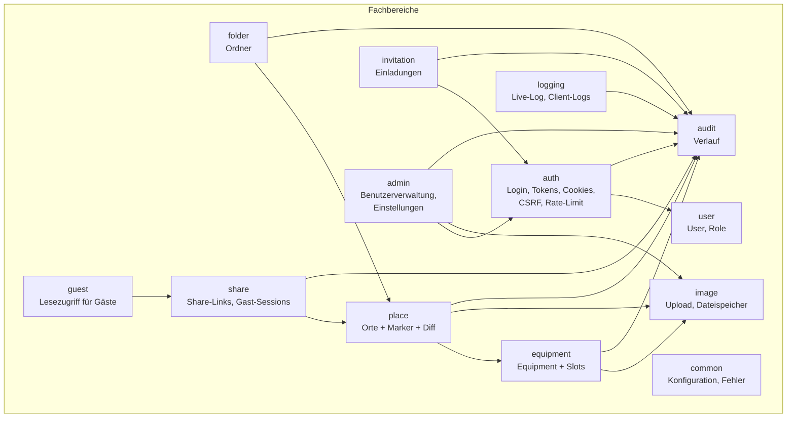

### 5.3 Datenmodell und Migrationen

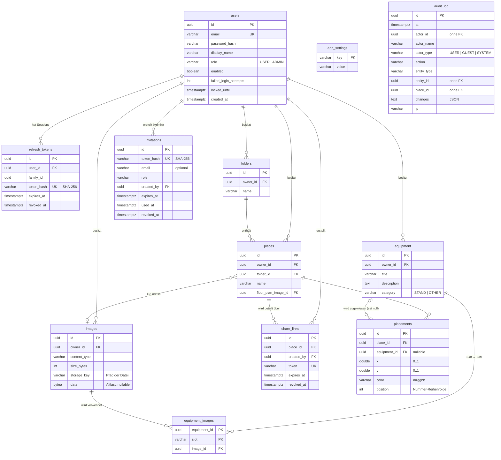

Hinweise zum Modell:

* **Löschverhalten:** Wird ein User gelöscht, löscht die DB (`on delete cascade`) seine Ordner, Orte, Marker, Equipment, Bilder-Zeilen,
  Tokens und Share-Links. Wird Equipment gelöscht, behalten Marker ihre Position, verlieren aber die Zuweisung (`set null`).
* **`audit_log` hat absichtlich keine Fremdschlüssel**, damit der Verlauf auch nach dem Löschen von Usern, Orten und Equipment
  erhalten bleibt (die Namen werden als Text mitgespeichert).
* **Tokens werden nie im Klartext gespeichert**: Refresh-Tokens und Einladungs-Tokens liegen nur als SHA-256-Hash in der DB. (Share-Link-Tokens
  werden im Klartext gespeichert, weil der Besitzer den Link später erneut anzeigen können muss.)
* `placements.position` sorgt dafür, dass Marker ihre **Nummer** behalten (`@OrderColumn`).

**Flyway-Migrationen** (`src/main/resources/db/migration`)

| Datei | Inhalt |
|---|---|
| `V1__init.sql` | Grundschema: `users`, `refresh_tokens`, `images` (damals mit Bytes in der DB), `folders`, `equipment`, `equipment_images`, `places`, `placements` inkl. Indizes und Check-Constraints (`category`, `x`/`y` zwischen 0 und 1). |
| `V2__admin_audit_sharing.sql` | `users.role`, `users.enabled` (der älteste Account wird bei Bestandsinstallationen Admin), `app_settings`, `share_links`, `audit_log`, `placements.position`. |
| `V3__images_on_disk.sql` | `images.storage_key` neu, `images.data` nullable. Das Verschieben der Bytes erledigt der `LegacyImageMigrator` beim Start. |
| `V4__invitations.sql` | Tabelle `invitations` (nur Token-Hash). |

### 5.4 Sicherheit im Detail

#### Filterkette (Reihenfolge)

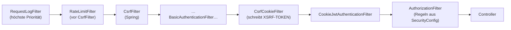

#### Authentifizierung per Cookie-JWT

Es gibt **zwei getrennte Identitäten**:

| | Benutzer | Gast |
|---|---|---|
| Cookie | `pp_access` (Pfad `/api`) | `pp_guest` (Pfad `/api`) |
| gilt für | alles außer `/api/guest/**` | nur `/api/guest/**` |
| Token | Claims: `sub`=User-ID, `role`, `name`, `iss`, `iat`, `exp` (15 min) | Claims: `typ=guest`, `sub`=Gast-ID, `name`, `share`, `place`, `exp` (max. 8 h, höchstens bis Link-Ablauf) |
| Rolle in Spring | `ROLE_USER` / `ROLE_ADMIN` | `ROLE_GUEST` |

Weitere Cookies: `pp_refresh` (Pfad `/api/auth`, 14 Tage, wird also nur an Auth-Endpunkte mitgesendet) und `XSRF-TOKEN` (für CSRF, für JavaScript lesbar).
Alle Auth-Cookies sind `HttpOnly` (kein JavaScript-Zugriff), `SameSite=Strict` und `Secure` gemäß `COOKIE_SECURE`.

**`CookieJwtAuthenticationFilter`** – bewusst **nicht** Springs Bearer-Token-Unterstützung: Diese schaltet CSRF-Schutz für Requests mit
Bearer-Token ab; das wäre falsch für ein Token, das der Browser automatisch mitsendet. Der Filter:

1. überspringt öffentliche Pfade (`/api/auth/csrf|register|login|refresh|logout`, `/api/share/*`, `/api/invite/*`), damit ein veraltetes Token sie nicht stört;
2. wählt das Cookie nach Pfad (`/api/guest/` → Gast-Cookie, sonst Access-Cookie);
3. dekodiert/prüft das JWT (Signatur, Issuer, Ablauf);
4. weist Token-Art/Bereich-Mismatch ab (Gast-Token auf User-API oder umgekehrt → nicht authentifiziert, Log `AUTH_TOKEN_KIND_MISMATCH`);
5. prüft bei Benutzer-Tokens `RevokedSessions` (siehe unten);
6. setzt den `SecurityContext` und die MDC-Variable `user` (erste 8 Zeichen der ID, für das Log).

**Autorisierungsregeln** (`SecurityConfig`): öffentlich sind `GET /api/auth/csrf`, `POST /api/auth/{register,login,refresh,logout}`,
`GET /api/invite/*`, `POST /api/invite/*/accept`, `GET /api/share/*`, `POST /api/share/*/guest` und `/actuator/health`.
`/api/guest/**` braucht `GUEST`, `/api/admin/**` braucht `ADMIN`, der Rest von `/api/**` `USER` oder `ADMIN`. Alles andere ist `denyAll`.
Nicht authentifiziert → `401`, ohne Berechtigung → `403`.

#### Refresh-Token-Rotation mit Diebstahl-Erkennung (`AuthService.refresh`)

Jeder Login erzeugt eine **Familie** (`family_id`). Bei jedem Refresh wird das alte Token widerrufen und ein neues derselben Familie ausgegeben.

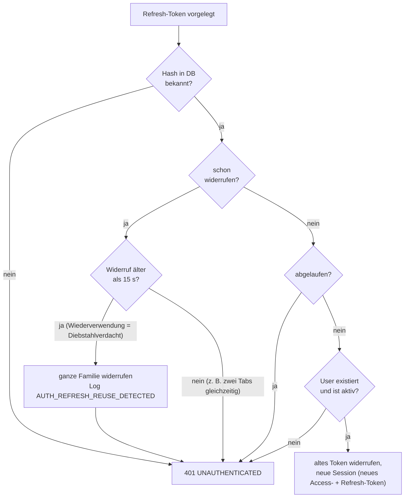

Die Schonfrist `REUSE_GRACE = 15 s` verhindert, dass zwei Browser-Tabs, die gleichzeitig refreshen, fälschlich als Diebstahl gelten.

#### Login-Schutz

* **Sperre:** 5 Fehlversuche → Account 15 Minuten gesperrt (`User.registerFailedLogin`). Danach Zähler zurück auf 0.
* **Einheitliche Antwort:** Unbekannte E-Mail, falsches Passwort, gesperrter oder deaktivierter Account liefern alle `401 INVALID_CREDENTIALS` –
  man kann also nicht erkennen, ob ein Konto existiert.
* **Zeitangleichung:** Bei unbekannter E-Mail wird trotzdem ein Passwort-Hash gegen einen „Dummy-Hash“ geprüft (`dummyHash`), sodass die
  Antwortzeit nicht verrät, ob die Adresse existiert.
* **Passwörter:** Argon2id (`Argon2PasswordEncoder.defaultsForSpringSecurity_v5_8`, benötigt BouncyCastle). 10–128 Zeichen,
  darf nicht der E-Mail-Adresse entsprechen.
* `@Transactional(noRollbackFor = ApiException.class)` bei Login/Refresh: Der Fehlversuchszähler und das Widerrufen der Familie werden
  auch dann gespeichert, wenn anschließend eine Exception geworfen wird.

#### CSRF (Double-Submit-Cookie)

Spring setzt das Cookie `XSRF-TOKEN` (lesbar für JS, `SameSite=Strict`). Jede **verändernde** Anfrage (alles außer GET/HEAD/OPTIONS/TRACE) muss
denselben Wert im Header `X-XSRF-TOKEN` mitschicken, sonst `403`. `CsrfCookieFilter` erzwingt, dass das Cookie in jeder Antwort geschrieben wird
(sonst ist Springs Token „lazy“). Das Frontend holt es bei Bedarf über `GET /api/auth/csrf`.
Das gilt auch für Login und Registrierung.

#### Rate-Limiting (`RateLimitFilter`)

Fester Zeitfenster-Zähler (1 Minute) pro Client-IP, im Arbeitsspeicher (reicht für eine Instanz). Nur **POST**-Anfragen werden gezählt:

| Bucket | Pfade | Limit pro Minute |
|---|---|---|
| `#credentials` | `/api/auth/login`, `/api/auth/register` | 10 |
| `#refresh` | `/api/auth/refresh`, `/api/share/**`, `/api/invite/**` | 30 |

Bei Überschreitung: `429`, Header `Retry-After`, Body `{"code":"RATE_LIMITED",…}`. Die Map wird bei > 10 000 Einträgen aufgeräumt.
Wegen `forward-headers-strategy: framework` ist die IP die des echten Clients – deshalb muss das Backend hinter dem Frontend-Proxy bleiben.

#### Sofortiges Sperren von Sessions (`RevokedSessions`)

Access-Tokens sind zustandslos und leben bis zu 15 Minuten. Deaktiviert/degradiert/löscht ein Admin einen Benutzer oder setzt dessen Passwort zurück,
merkt sich `RevokedSessions` pro Benutzer einen Zeitpunkt; **alle davor ausgestellten Tokens** werden abgelehnt (Token-Zeitstempel haben
Sekundenauflösung, deshalb wird auf die nächste Sekunde aufgerundet). Alte Einträge verfallen nach TTL + 60 s. Die Liste liegt im Speicher – nach einem
Neustart sind ohnehin nur noch maximal 15 Minuten alte Tokens im Umlauf. Gast-Tokens prüfen stattdessen bei **jeder** Anfrage den Share-Link.

#### Sicherheits-Header

* Backend: CSP `default-src 'none'; frame-ancestors 'none'`, `Referrer-Policy: no-referrer`, `X-Frame-Options: DENY`.
* Frontend: siehe [6.2](#62-konfiguration-nextconfigts).

### 5.5 Ablaufdiagramme

#### Registrierung / Login

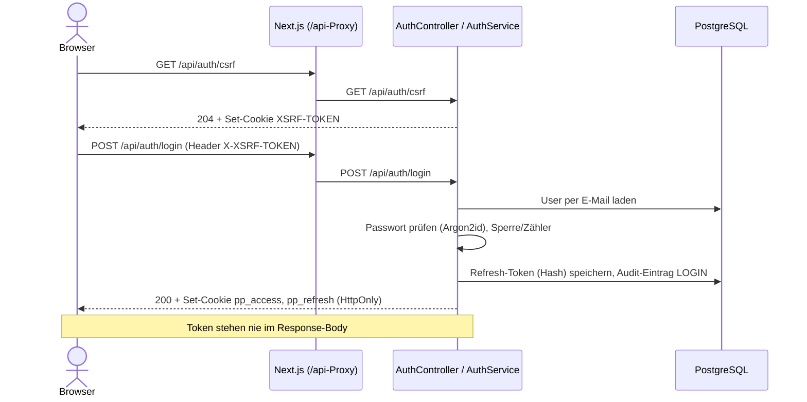

Registrierung (`POST /api/auth/register`) läuft gleich ab; zusätzlich: der **erste** Account (`users.count() == 0`) wird `ADMIN`; danach
ist Registrierung nur erlaubt, wenn `SettingsService.registrationEnabled()` wahr ist, sonst `403 REGISTRATION_DISABLED`.

#### Automatische Erneuerung (Frontend + Backend)

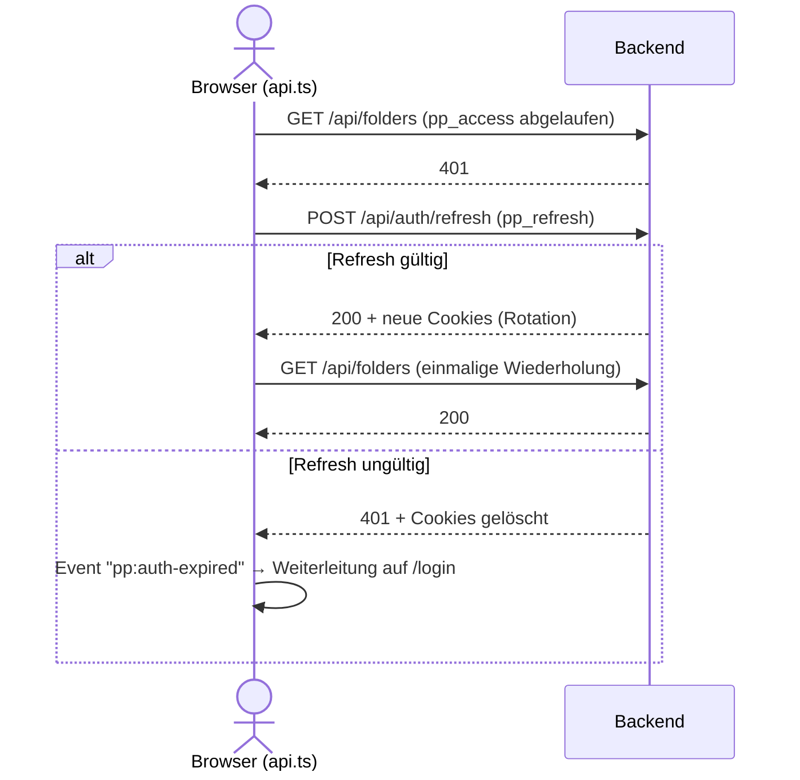

#### Einladung

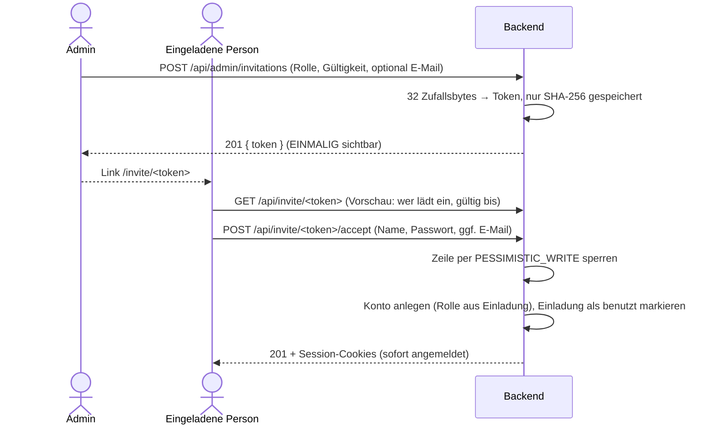

Die Zeilensperre (`findByTokenHashForUpdate`) verhindert, dass zwei Personen mit demselben Link gleichzeitig je ein Konto anlegen.
Status einer Einladung: `PENDING`, `USED`, `REVOKED`, `EXPIRED`. Ungültige Links liefern immer `404 INVITE_INVALID` (kein Hinweis, warum).

#### Share-Link und Gast

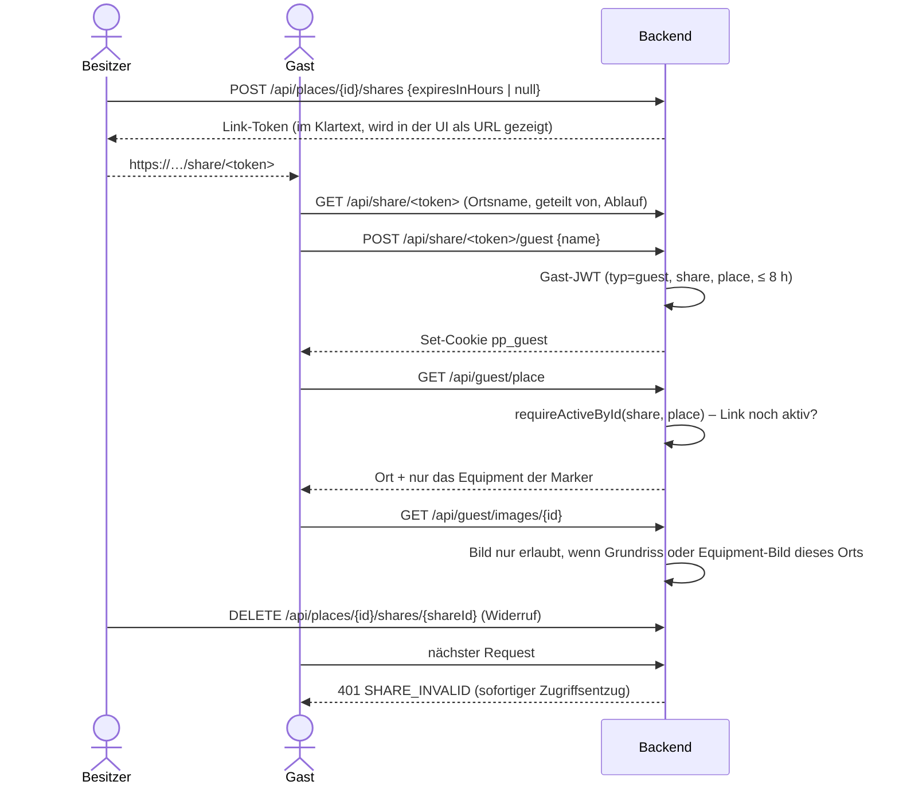

#### Ort speichern (Marker-Abgleich)

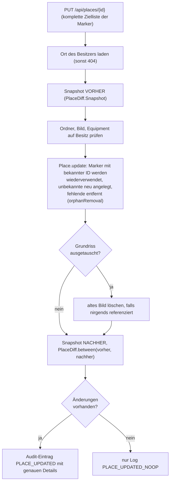

### 5.6 API-Referenz

Alle Pfade beginnen mit `/api`. „User“ = `USER` oder `ADMIN`. Alle schreibenden Methoden brauchen den CSRF-Header (siehe oben).
Fehler haben immer die Form `{ "code": "...", "message": "...", "fields": { feld: meldung } }` (siehe [5.8](#58-fehlerbehandlung-und-fehlercodes)).

#### Auth – `AuthController`

| Methode & Pfad | Zugriff | Zweck | Antwort |
|---|---|---|---|
| `GET /auth/csrf` | öffentlich | Setzt das `XSRF-TOKEN`-Cookie | 204 |
| `POST /auth/register` | öffentlich, Rate-Limit | Konto anlegen (`email`, `password` 10–128, `displayName` ≤ 80) | 201 `UserResponse` + Cookies |
| `POST /auth/login` | öffentlich, Rate-Limit | Anmelden | 200 `UserResponse` + Cookies |
| `POST /auth/refresh` | öffentlich, Rate-Limit | Refresh-Rotation; bei Fehler Cookies löschen | 200 / 401 |
| `POST /auth/logout` | öffentlich | Session-Familie widerrufen, Cookies löschen | 204 |
| `GET /auth/me` | User | Aktueller Benutzer | `UserResponse` |
| `PATCH /auth/profile` | User | Anzeigename ändern | `UserResponse` |
| `POST /auth/password` | User | Passwort ändern (`currentPassword`, `newPassword`), beendet **alle anderen** Sessions, gibt neue Session | `UserResponse` + Cookies |

`UserResponse = { id, email, displayName, role }`.

#### Ordner – `FolderController`

| Methode & Pfad | Zweck |
|---|---|
| `GET /folders` | Alle Ordner (nach Name) **mit ihren Orten** (`PlaceSummary`) |
| `POST /folders` `{name ≤ 100}` | Ordner anlegen (201) |
| `PATCH /folders/{id}` `{name}` | Umbenennen |
| `DELETE /folders/{id}` | Ordner **und alle Orte darin** löschen (204) |

#### Orte – `PlaceController`, `PlaceActivityController`

| Methode & Pfad | Zweck |
|---|---|
| `GET /places/{id}` | Ort mit Markern |
| `POST /places` | Ort anlegen (201) |
| `PUT /places/{id}` | Name, Ordner, Grundriss und **komplette** Markerliste ersetzen |
| `DELETE /places/{id}` | Ort löschen (204) |
| `GET /places/{id}/activity?page&size` | Verlauf des Ortes – Besitzer und Admins; nur Admins sehen IPs |

Request `PlaceRequest`: `name` (1–120), `folderId`, `floorPlanImageId`, `placements` (max. 200). Jeder Marker: optional `id` (nur für bereits
gespeicherte Marker), `x`/`y` (0.0–1.0), optional `equipmentId`, `color` (`#rrggbb`).

#### Equipment – `EquipmentController`

| Methode & Pfad | Zweck |
|---|---|
| `GET /equipment` | Alle (nach Titel) |
| `GET /equipment/{id}` | Eines |
| `POST /equipment` | Anlegen (201) |
| `PUT /equipment/{id}` | Titel, Beschreibung (≤ 4000), Kategorie, Bilder ersetzen |
| `DELETE /equipment/{id}` | Löschen; Marker verlieren die Zuweisung |

`images` ist eine Map `Slot → Bild-ID`. Slots: `TOP_BAR_ADD_1`, `TOP_BAR_ADD_2`, `TOP_BAR`, `FOOT`, `LIGHT_1`…`LIGHT_5` (nur `STAND`) und `PHOTO` (nur `OTHER`, Pflicht).

#### Bilder – `ImageController`

| Methode & Pfad | Zweck |
|---|---|
| `POST /images` (multipart, Feld `file`) | Upload; antwortet `201 { id }` |
| `GET /images/{id}` | Datei streamen (nur eigene Bilder), `Cache-Control: private, max-age=365d, immutable`, `X-Content-Type-Options: nosniff` |

#### Freigabe – `ShareController`

| Methode & Pfad | Zugriff | Zweck |
|---|---|---|
| `GET /places/{placeId}/shares` | Besitzer | Links des Ortes |
| `POST /places/{placeId}/shares` `{expiresInHours: 1–8760 \| null}` | Besitzer | Link erstellen (`null` = unbegrenzt) |
| `DELETE /places/{placeId}/shares/{shareId}` | Besitzer | Widerrufen |
| `GET /share/{token}` | öffentlich | Vorschau `{placeName, sharedBy, expiresAt}` |
| `POST /share/{token}/guest` `{name ≤ 60}` | öffentlich, Rate-Limit | Gast-Session starten (Cookie `pp_guest`) |
| `POST /guest/logout` | Gast | Gast-Cookie löschen |

#### Gast – `GuestController`

| Methode & Pfad | Zweck |
|---|---|
| `GET /guest/place` | `{guestName, place, equipment[]}` – nur Equipment, das auf den Markern verwendet wird |
| `GET /guest/images/{id}` | Bild, nur wenn Grundriss oder Equipment-Bild dieses einen Ortes (sonst 404); Cache 1 h, privat |

#### Einladungen – `InvitationController`

| Methode & Pfad | Zugriff | Zweck |
|---|---|---|
| `POST /admin/invitations` `{email?, role, expiresInHours 1–720}` | Admin | Erstellen; Token **nur in dieser Antwort** |
| `GET /admin/invitations` | Admin | Die letzten 50 mit Status |
| `DELETE /admin/invitations/{id}` | Admin | Offene Einladung widerrufen |
| `GET /invite/{token}` | öffentlich | Vorschau `{email, invitedBy, expiresAt}` |
| `POST /invite/{token}/accept` `{email?, displayName, password}` | öffentlich, Rate-Limit | Konto anlegen und anmelden (201 + Cookies) |

#### Admin – `AdminController`, `AdminLogController`

| Methode & Pfad | Zweck |
|---|---|
| `GET /admin/users` | Alle Konten mit `enabled`, `locked`, Anzahl Orte/Equipment |
| `POST /admin/users` | Konto direkt anlegen (E-Mail, Name, Passwort, Rolle) |
| `PATCH /admin/users/{id}` | Teilupdate: `role`, `enabled`, `displayName` (nur gesetzte Felder) |
| `POST /admin/users/{id}/password` | Passwort zurücksetzen (beendet alle Sessions, hebt Sperre auf) |
| `POST /admin/users/{id}/unlock` | Login-Sperre aufheben |
| `DELETE /admin/users/{id}` | Konto samt aller Daten löschen |
| `GET` / `PUT /admin/settings` | `{registrationEnabled}` lesen / setzen (wird auditiert) |
| `GET /admin/audit?placeId&page&size` | Gesamter Verlauf inkl. IPs (Seitengröße 1–100, Standard 30) |
| `GET /admin/places` | Alle Orte aller Benutzer (für den Audit-Filter) |
| `GET /admin/logs?limit` | Letzte Logzeilen (1–3000, Standard 500) |
| `GET /admin/logs/stream?backlog` | Live-Log als Server-Sent Events |
| `GET` / `PUT /admin/logs/level` | Log-Level von `app.partyplaner` lesen/ändern (`DEBUG`/`INFO`/`WARN`/`ERROR`) |

#### Sonstiges

| Methode & Pfad | Zugriff | Zweck |
|---|---|---|
| `POST /client-logs` | User | Browser-Logzeilen entgegennehmen (≤ 50 pro Anfrage) |
| `GET /actuator/health` | öffentlich | Health-Check (nur intern genutzt) |

### 5.7 Die Pakete einzeln

#### `common`

| Klasse | Aufgabe |
|---|---|
| `AppProperties` | Typisierte, validierte Konfiguration (`app.*`). |
| `ApiException` | Erwarteter Client-Fehler mit HTTP-Status + stabilem `code`. Fabriken `notFound(what)` und `badRequest(code, msg)`. |
| `ErrorResponse` | Einheitlicher Fehler-Body `{code, message, fields}`. |
| `GlobalExceptionHandler` | `@RestControllerAdvice`: wandelt Ausnahmen in `ErrorResponse` um (siehe 5.8). Unerwartete Fehler werden mit Stacktrace geloggt, aber nach außen nur als generisches `500` gemeldet. |
| `CurrentUser` | Liest die User-ID (`sub`) aus dem JWT. |

#### `user`

| Klasse | Aufgabe |
|---|---|
| `Role` | Enum `USER`, `ADMIN`. |
| `User` | Entity „users“: E-Mail (immer klein geschrieben), Passwort-Hash, Anzeigename, Rolle, `enabled`, Fehlversuchszähler, `lockedUntil`. Methoden: `isLocked(now)`, `registerFailedLogin(max, dauer, now)`, `registerSuccessfulLogin()`, `unlock()`. |
| `UserRepository` | `findByEmail`, `existsByEmail`, `countByRoleAndEnabled` (für den Schutz des letzten Admins), `findAllByOrderByCreatedAtAsc`. |

#### `auth`

| Klasse | Aufgabe |
|---|---|
| `AuthController` | Endpunkte aus 5.6. Baut Antworten, die beide Token-Cookies setzen (`withSession`). Bei fehlgeschlagenem Refresh werden die Cookies gelöscht. |
| `AuthService` | Registrierung (erster Account = Admin), Einladungs-Registrierung (`registerInvited`), Login mit Sperre, Refresh-Rotation, Logout, Profil, Passwortwechsel; erzeugt Sessions (`newSession`: 32 Zufallsbytes als Refresh-Token, Hash gespeichert, plus Access-JWT). Nächtlicher Job `purgeExpiredTokens`. |
| `AuthDtos` | Request-/Response-Records mit Bean-Validation. Die Meldung `PASSWORD_LENGTH` ist ein Schlüssel, den das Frontend übersetzt. |
| `AuthCookies` | Baut und löscht die Cookies `pp_access`, `pp_refresh`, `pp_guest` (HttpOnly, SameSite=Strict, Secure nach Konfiguration, Pfade s. o.); `read(request, name)` liest ein Cookie. |
| `JwtService` | Erzeugt HS256-JWTs: Access-Token (`role`, `name`) und Gast-Token (`typ=guest`, `share`, `place`). |
| `JwtKeys` | Leitet den HMAC-Schlüssel aus `jwt-secret` ab. |
| `CookieJwtAuthenticationFilter` | Siehe 5.4. |
| `CsrfCookieFilter` | Erzwingt das Schreiben des `XSRF-TOKEN`-Cookies. |
| `RateLimitFilter` | Siehe 5.4. |
| `RevokedSessions` | Siehe 5.4. |
| `RefreshToken` / `RefreshTokenRepository` | Entity mit Token-Hash, Familie, Ablauf, Widerrufszeit. Repository mit Massen-Updates `revokeFamily`, `revokeAllForUser`, `deleteExpired`. |
| `SecurityConfig` | Passwort-Encoder (Argon2id), `JwtDecoder` (HS256, Issuer-Prüfung), `SecurityFilterChain` (stateless, CSRF, Header, Regeln, Filter-Reihenfolge; Antwort `401` statt Login-Redirect). |

#### `admin`

| Klasse | Aufgabe |
|---|---|
| `AdminController` | Endpunkte aus 5.6 (Benutzer, Einstellungen, Audit, Ortsliste). Hat keine eigene Logik, ruft `AdminUserService`, `SettingsService`, `AuditService`. |
| `AdminUserService` | `create`, `update`, `resetPassword`, `unlock`, `delete`. **Schutzregeln (`guardAdminLoss`)**: man kann sich selbst weder degradieren, deaktivieren noch löschen (`CANNOT_MODIFY_SELF`), und der **letzte aktive Admin** kann nie entfernt werden (`LAST_ADMIN`). Änderungen an Rolle/Status, Passwort-Reset und Löschen widerrufen sofort die laufenden Access-Tokens; Deaktivieren und Reset widerrufen zusätzlich alle Refresh-Tokens. Beim Löschen werden die Bilddateien erst **nach dem Commit** entfernt. |
| `SettingsService` | Liest/schreibt `registration_enabled` in `app_settings`; ohne DB-Eintrag gilt der Wert aus der Konfiguration. |
| `AppSetting`, `AppSettingRepository` | Key/Value-Entity der Tabelle `app_settings`. |

#### `folder`

| Klasse | Aufgabe |
|---|---|
| `Folder` | Entity (Besitzer, Name). |
| `FolderRepository` | `findByOwnerIdOrderByNameAsc`, `findByIdAndOwnerId`. |
| `FolderService` | Liste (gruppiert die Orte pro Ordner), Anlegen, Umbenennen, Löschen. Beim Löschen werden zuerst alle Orte über `PlaceService.deleteAllInFolder` entfernt (inkl. Bilder und Audit-Einträge mit Grund `FOLDER_DELETED`). |
| `FolderController`, `FolderDtos` | Endpunkte und Records (`FolderRequest`, `FolderResponse`). |

#### `place`

| Klasse | Aufgabe |
|---|---|
| `Place` | Entity. Besitzt die Markerliste (`@OneToMany`, `cascade ALL`, `orphanRemoval`, `@OrderColumn position`). `update(...)` gleicht Marker über ihre ID ab: bekannte IDs bleiben erhalten (so kann der Verlauf einen Marker über Änderungen verfolgen), unbekannte werden neu angelegt, weggelassene verschwinden. Eine ID wird pro Anfrage nur einmal wiederverwendet. |
| `Placement` | Marker: `x`, `y` (0–1 relativ zur Bildbreite/-höhe), `color`, optional `equipmentId`. |
| `PlaceRepository` | Besitzer-bezogene Abfragen; `findUsingEquipment(equipmentId)` (Orte, die ein Equipment verwenden); `findAllByOrderByNameAsc` (Admin). |
| `PlaceService` | Anlegen/Ändern/Löschen. Prüft, dass Ordner, Bild und alle Equipments dem Besitzer gehören, normalisiert Farben auf Kleinbuchstaben, löscht ersetzte/verwaiste Grundrissbilder und schreibt den Audit-Diff. |
| `PlaceDiff` | Rechnet aus zwei Snapshots („vorher/nachher“) die Änderungen aus: `NAME`, `FOLDER`, `FLOOR_PLAN_REPLACED`, `MARKER_ADDED`, `MARKER_REMOVED`, `MARKER_EQUIPMENT`, `MARKER_COLOR`, `MARKER_MOVED` (erst ab einer Verschiebung > 0,005 = 0,5 % des Bildes, damit Mini-Zuckungen nicht im Verlauf landen). Marker werden mit ihrer **Nummer** (Listenposition + 1) benannt. |
| `PlaceActivityController` | Verlauf eines Ortes; Admins dürfen jeden Ort sehen (und IPs), Besitzer nur ihre. |
| `PlaceDtos` | `PlaceRequest`, `PlacementRequest`, `PlaceResponse`, `PlacementResponse`, `PlaceSummary`. |

#### `equipment`

| Klasse | Aufgabe |
|---|---|
| `EquipmentCategory` | `STAND` oder `OTHER`. |
| `EquipmentSlot` | Bildpositionen. `allowedFor(category)`: `PHOTO` nur für `OTHER`, alle anderen Slots nur für `STAND`. |
| `Equipment` | Entity mit `@ElementCollection` `Map<EquipmentSlot, UUID>` (Tabelle `equipment_images`). `update(...)` ersetzt Inhalte und setzt `updatedAt`. |
| `EquipmentRepository` | Besitzer-bezogene Abfragen, `countByIdInAndOwnerId` (Besitzprüfung). |
| `EquipmentService` | Validiert Slot ↔ Kategorie (`SLOT_INVALID`), `PHOTO_REQUIRED`, Bildbesitz; löscht nicht mehr referenzierte Bilder; schreibt Audit-Diffs (`TITLE`, `DESCRIPTION`, `CATEGORY`, `IMAGE_ADDED/REMOVED/REPLACED` pro Slot). Beim **Löschen** trägt es in den Verlauf jedes betroffenen Ortes ein, dass der Marker sein Equipment verloren hat (`MARKER_EQUIPMENT`). `requireOwned` wird vom `PlaceService` genutzt. |
| `EquipmentController`, `EquipmentDtos` | Endpunkte und Records. |

#### `image`

| Klasse | Aufgabe |
|---|---|
| `Image` | Metadaten (Besitzer, Content-Type, Größe, `storageKey`). Die Bytes liegen **nicht** in der DB. |
| `ImageStorage` | Der **einzige** Code, der Dateien anfasst. Schlüssel haben die Form `ab/ab12….png` (erste zwei Zeichen der UUID als Unterordner) und entstehen nur aus UUID + fester Endung, nie aus Benutzereingaben; `resolve()` prüft zusätzlich, dass der Pfad im Wurzelverzeichnis bleibt (Schutz vor Path-Traversal). Schreiben erfolgt **atomar** (temporäre Datei → `ATOMIC_MOVE`); rollt die DB-Transaktion zurück, wird die Datei wieder entfernt. Löschen geschieht erst **nach dem Commit** (`deleteAfterCommit`). Beim Start wird das Verzeichnis angelegt und auf Schreibbarkeit geprüft (Fail-Fast). |
| `ImageService` | `store`: leer? (`IMAGE_EMPTY`), > 5 MB? (`IMAGE_TOO_LARGE`), Typ per **Magic Bytes** (PNG `89 50 4E 47`, JPEG `FF D8 FF`, WebP `RIFF….WEBP`) – Dateiname und vom Client gemeldeter Typ werden ignoriert (`IMAGE_UNSUPPORTED`, 415). `requireOwned`, `deleteUnreferenced`, `keysOwnedBy`, nächtlicher Aufräumjob. |
| `ImageRepository` | Native Abfragen: unreferenzierte Bilder finden/löschen (nicht in `equipment_images`, nicht als `floor_plan_image_id`). |
| `ImageController` | Upload und Download (siehe 5.6). |
| `LegacyImageMigrator` | Einmalige Migration beim Start: Bilder, die noch als `bytea` in der DB liegen, werden auf Platte geschrieben, **danach** wird `data` geleert (ein Absturz kann so nie ein Bild verlieren). Idempotent. |

#### `share` und `guest`

| Klasse | Aufgabe |
|---|---|
| `ShareLink` | Entity: Ort, Ersteller, Token, optionales Ablaufdatum, Widerrufszeit. `isActive(now)`. |
| `ShareService` | Links auflisten/erstellen (32 Zufallsbytes, URL-sicheres Base64)/widerrufen, öffentliche Vorschau, `joinAsGuest` (bereinigt den Namen von Steuerzeichen, Gast-Token ≤ 8 h und nie länger als der Link; Audit `GUEST_JOINED`), `requireActiveById` (wird bei jeder Gast-Anfrage aufgerufen). |
| `ShareController`, `ShareDtos` | Endpunkte und Records. Das Token wird nie geloggt. |
| `GuestController` | Nur-Lese-API für Gäste. Jede Anfrage prüft erneut, dass der Link aktiv ist, und liefert ausschließlich Daten **dieses** Ortes (Bilder nur, wenn sie zum Ort oder zu dessen Equipment gehören). |

#### `invitation`

| Klasse | Aufgabe |
|---|---|
| `Invitation` | Entity mit Token-Hash, optionaler fester E-Mail, Rolle, Ersteller, Ablauf, `usedAt/usedBy/revokedAt`; `status(now)`. |
| `InvitationService` | Erstellen (Token nur in der Antwort), Auflisten, Widerrufen (nur wenn `PENDING`), Vorschau, `accept` (Zeilensperre, Konto über `AuthService.registerInvited`, Einladung verbrennen, Audit). Ist eine E-Mail in der Einladung fest vorgegeben, gewinnt sie gegenüber der Eingabe. |
| `InvitationRepository` | Inkl. `findByTokenHashForUpdate` (`PESSIMISTIC_WRITE`) und `findTop50ByOrderByCreatedAtDesc`. |
| `InvitationController` | Admin- und öffentliche Endpunkte. |

#### `audit`

| Klasse | Aufgabe |
|---|---|
| `Actor` | Wer handelt: `USER`, `GUEST` oder `SYSTEM`. `Actor.current()` liest ihn aus dem JWT der laufenden Anfrage (außerhalb einer Anfrage: System). |
| `Change` | Eine Änderungszeile: `code` (vom Frontend übersetzt), `ref` (z. B. Marker-Nummer), `from`, `to`. |
| `AuditLog` | Entity (ohne Fremdschlüssel); `changes` ist JSON-Text. |
| `AuditService` | `record(...)` schreibt in **derselben Transaktion** wie die Änderung – ein Eintrag existiert also genau dann, wenn die Änderung committed wurde. Speichert die Client-IP. `page(placeId, page, size, includeIp)` liefert Seiten (neueste zuerst); IPs nur, wenn verlangt (Admin). Namen werden gekürzt (Entity 200, Ort 120 Zeichen). |
| `AuditDtos` | `AuditEntry`, `PageResponse<T>`. |
| `AuditLogRepository` | Seiten, sortiert nach `at` absteigend, optional pro Ort. |

#### `logging`

| Klasse | Aufgabe |
|---|---|
| `RequestLogFilter` | Vergibt jeder Anfrage eine ID (übernimmt `X-Request-Id`, wenn sie dem Muster `[A-Za-z0-9-]{4,36}` entspricht), setzt sie in die MDC und den Antwort-Header und schreibt **eine** Zeile `HTTP METHOD PFAD -> STATUS (ms)`. Level: 5xx = ERROR, 4xx (außer 401) = WARN, 401 und alle verändernden Requests = INFO, sonst DEBUG. Der Live-Stream und `/actuator` werden nicht protokolliert. |
| `LogBuffer` | Logback-Appender auf dem Root-Logger: hält die letzten **3000** Zeilen im Speicher, vergibt laufende Nummern (`seq`) und verteilt neue Zeilen an Abonnenten (Live-Log). Stacktraces werden auf 6000 Zeichen gekürzt. |
| `LogEntry` | Eine Zeile: `seq, ts, level, logger, thread, message, requestId, user, stack`. |
| `AdminLogController` | Snapshot, SSE-Stream (Backlog zuerst, Wiederaufnahme per `Last-Event-ID`; ein einzelner Sender-Thread serialisiert das Senden) und Lesen/Ändern des Log-Levels zur Laufzeit (auditiert). |
| `ClientLogController` | Nimmt Browser-Logs an. Alles vom Client ist **untrusted**: Steuerzeichen werden entfernt (kein Log-Forging), Längen begrenzt, Level auf `error/warn/debug/info` abgebildet. Logger-Name `app.partyplaner.client`. |

### 5.8 Fehlerbehandlung und Fehlercodes

`GlobalExceptionHandler` übersetzt:

| Ausnahme | Status | Code |
|---|---|---|
| `ApiException` | wie gesetzt | wie gesetzt |
| `MethodArgumentNotValidException` (Bean-Validation) | 400 | `VALIDATION_FAILED` + `fields` (Feld → Meldung) |
| `ConstraintViolationException` | 400 | `VALIDATION_FAILED` |
| unlesbares JSON / fehlender Multipart-Teil | 400 | `BAD_REQUEST` |
| Upload über Limit | 413 | `IMAGE_TOO_LARGE` |
| `AccessDeniedException` | 403 | `FORBIDDEN` |
| Spring-`ErrorResponse` (z. B. 405) | wie Quelle | `HTTP_ERROR` |
| alles andere | 500 | `INTERNAL_ERROR` (Details nur im Log) |

Bekannte `code`-Werte, die das Frontend unter `errors.<CODE>` übersetzt:

| Code | Bedeutung |
|---|---|
| `INVALID_CREDENTIALS` | Login fehlgeschlagen (einheitlich, siehe 5.4) |
| `UNAUTHENTICATED` | Nicht (mehr) angemeldet / Refresh ungültig |
| `FORBIDDEN` | Keine Berechtigung (auch CSRF-Fehler) |
| `NOT_FOUND` | Nicht vorhanden **oder nicht dem Benutzer gehörend** |
| `RATE_LIMITED` | Zu viele Anfragen (429) |
| `VALIDATION_FAILED` | Eingabe ungültig |
| `REGISTRATION_DISABLED` | Registrierung geschlossen |
| `EMAIL_TAKEN` | E-Mail bereits registriert |
| `PASSWORD_WEAK` | Passwort entspricht der E-Mail |
| `WRONG_PASSWORD` | Aktuelles Passwort falsch |
| `CANNOT_MODIFY_SELF` | Admin-Aktion gegen das eigene Konto |
| `LAST_ADMIN` | Letzter aktiver Admin |
| `INVITE_INVALID` | Einladung unbekannt/benutzt/widerrufen/abgelaufen |
| `SHARE_INVALID` | Share-Link ungültig/widerrufen/abgelaufen |
| `IMAGE_EMPTY`, `IMAGE_TOO_LARGE`, `IMAGE_UNSUPPORTED`, `IMAGE_UNREADABLE`, `IMAGE_INVALID` | Bild-Upload/-Referenz |
| `SLOT_INVALID`, `PHOTO_REQUIRED`, `EQUIPMENT_INVALID` | Equipment-Regeln |
| `BAD_REQUEST`, `HTTP_ERROR`, `INTERNAL_ERROR` | Allgemein |
| `NETWORK` | Nur im Frontend: Server nicht erreichbar |

### 5.9 Audit-Log (Verlauf)

Der Verlauf beantwortet **wer, was, wann, wo, wie**. Jede Zeile hat `actor` (Name + Typ), `action`, `entityType/-Id/-Name`, optional `place`,
eine Liste `changes` und die IP. Er wird in der Transaktion der eigentlichen Änderung geschrieben.

**Aktionen (`action`)**: `USER_REGISTERED`, `LOGIN`, `LOGIN_FAILED`, `LOGOUT`, `PROFILE_UPDATED`, `PASSWORD_CHANGED`, `USER_CREATED`,
`USER_UPDATED`, `USER_PASSWORD_RESET`, `USER_UNLOCKED`, `USER_DELETED`, `SETTINGS_CHANGED`, `LOG_LEVEL_CHANGED`,
`FOLDER_CREATED/RENAMED/DELETED`, `EQUIPMENT_CREATED/UPDATED/DELETED`, `PLACE_CREATED/UPDATED/DELETED`,
`SHARE_CREATED/REVOKED`, `GUEST_JOINED`, `INVITATION_CREATED/REVOKED/ACCEPTED`.

**Änderungscodes (`change.code`)**: `NAME`, `ROLE`, `ENABLED`, `DISABLED`, `FIRST_ADMIN`, `ACCOUNT_DISABLED`, `ACCOUNT_LOCKED`, `PLACES_COUNT`,
`REGISTRATION`, `LOG_LEVEL`, `TITLE`, `DESCRIPTION`, `CATEGORY`, `IMAGE_ADDED/REMOVED/REPLACED`, `FOLDER`, `FLOOR_PLAN_REPLACED`,
`MARKERS_COUNT`, `MARKER_ADDED/REMOVED/MOVED/COLOR/EQUIPMENT`, `FOLDER_DELETED`, `EXPIRES`.

Sichtbarkeit: Besitzer sehen den Verlauf **ihres** Ortes (ohne IP), Admins alles inkl. IP (auch von bereits gelöschten Orten).

### 5.10 Logging

* Format: `EVENT_CODE key=value …`, z. B. `AUTH_LOGIN_OK user=…`. Jede Zeile trägt `[requestId] [user]`.
* Die Request-ID steht auch im Antwort-Header `X-Request-Id`. Damit lässt sich ein Frontend-Fehler einer Server-Zeile zuordnen.
* **Niemals geloggt**: Passwörter, Tokens, Share-/Einladungs-Secrets.
* Das Frontend sendet seine eigenen Ereignisse an `/api/client-logs`, sodass der Live-Log (Einstellungen → Live-Log) beides zeigt.

### 5.11 Geplante Jobs

| Zeit (Server) | Job | Aktion |
|---|---|---|
| täglich 03:17 | `AuthService.purgeExpiredTokens` | Löscht Refresh-Tokens, die seit mehr als einem Tag abgelaufen sind. |
| täglich 03:43 | `ImageService.purgeOrphans` | Löscht Bilder (Zeile + Datei), die älter als 24 h und nirgends referenziert sind; danach `sweepStrayFiles`: Dateien, zu denen es keine DB-Zeile gibt (z. B. Absturz zwischen Schreiben und Commit), werden entfernt. Fremde Dateien (nicht UUID-benannt) bleiben unberührt. |

---

## 6. Frontend (Next.js)

Next.js 16 (App Router) mit React 19, TypeScript, Tailwind CSS 4, `next-intl` (de/en), TanStack Query 5, `lucide-react` (Icons),
`browser-image-compression` und `clsx`.

### 6.1 Aufbau und Routen

Die Route-Gruppen in Klammern (`(app)`, `(auth)` …) ändern die URL nicht, sondern bestimmen nur das **Layout**.

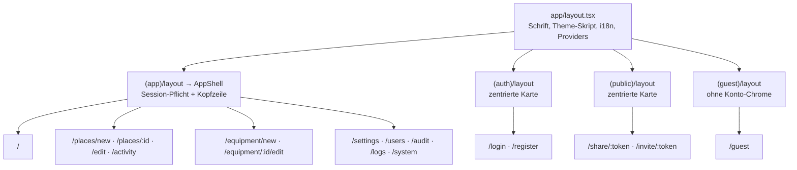

| URL | Datei | Komponente | Zugriff |
|---|---|---|---|
| `/` | `(app)/page.tsx` | `Dashboard` | angemeldet |
| `/places/new` | `(app)/places/new/page.tsx` | `PlaceForm` | angemeldet |
| `/places/:id` | `(app)/places/[id]/page.tsx` | `PlaceView` | angemeldet (Besitzer) |
| `/places/:id/edit` | `…/edit/page.tsx` | `EditPlaceView` → `PlaceForm` | Besitzer |
| `/places/:id/activity` | `…/activity/page.tsx` | `PlaceActivityView` | Besitzer / Admin |
| `/equipment/new` | `(app)/equipment/new/page.tsx` | `EquipmentForm` | angemeldet |
| `/equipment/:id/edit` | `…/edit/page.tsx` | `EditEquipmentView` → `EquipmentForm` | Besitzer |
| `/settings` | `(app)/settings/page.tsx` | `ProfileSettings` | angemeldet |
| `/settings/users` | `…/users/page.tsx` | `UsersAdmin` | Admin (`AdminOnly`) |
| `/settings/audit` | `…/audit/page.tsx` | `AuditAdmin` | Admin |
| `/settings/logs` | `…/logs/page.tsx` | `LiveLog` | Admin |
| `/settings/system` | `…/system/page.tsx` | `SystemSettings` | Admin |
| `/login`, `/register` | `(auth)/…` | `AuthForm` | öffentlich |
| `/share/:token` | `(public)/share/[token]/page.tsx` | `ShareLanding` | öffentlich |
| `/invite/:token` | `(public)/invite/[token]/page.tsx` | `InviteAccept` | öffentlich |
| `/guest` | `(guest)/guest/page.tsx` | `GuestPlaceView` | Gast |

Weitere Dateien in `app/`:

* `layout.tsx` – Root-Layout: Schrift *Kumbh Sans*, `<html lang>` aus dem Locale-Cookie, **Theme-Skript** im `<head>` (läuft vor dem ersten Rendern,
  damit kein „Aufblitzen“ des falschen Themes entsteht), `NextIntlClientProvider`, `Providers`. Setzt Viewport (inkl. `viewport-fit=cover` für Notch-Geräte) und Theme-Farben.
* `manifest.ts` – PWA-Manifest (Installation auf dem Homescreen; `display: standalone`).
* `error.tsx` – Fehlergrenze für Render-Fehler; meldet `RENDER_ERROR` an den Server und bietet „Erneut versuchen“.
* `global-error.tsx` – letzte Rückfallebene (ersetzt das Root-Layout, daher zweisprachig fest verdrahtet, keine Übersetzungen).
* `globals.css` – Theme (siehe 6.4).
* `settings/layout.tsx` – Rahmen der Einstellungen: Titel + `SettingsNav` neben dem Inhalt.

Die Seiten-Dateien sind absichtlich **dünn**: sie setzen Titel (`generateMetadata`) und rendern die eigentliche Komponente.

### 6.2 Konfiguration (`next.config.ts`)

* `output: "standalone"` – schlankes Produktions-Bundle für Docker.
* **Rewrite** `/api/:path*` → `${BACKEND_URL}/api/:path*` (Standard lokal `http://localhost:8080`, im Docker-Build `http://backend:8080`).
* **Sicherheits-Header** für alle Seiten:
  * `Content-Security-Policy`: `default-src 'self'`; Skripte `'self' 'unsafe-inline'` (+ `'unsafe-eval'` nur in der Entwicklung); Bilder `'self' blob: data:`;
    `connect-src 'self'`; `frame-ancestors 'none'`; `object-src 'none'` u. a. Es werden also keine fremden Server kontaktiert.
  * `X-Content-Type-Options: nosniff`, `X-Frame-Options: DENY`, `Referrer-Policy: strict-origin-when-cross-origin`,
    `Permissions-Policy: camera=(), microphone=(), geolocation=()`.
* `poweredByHeader: false`; Turbopack-Regel für Tailwind-CSS; `next-intl`-Plugin mit `src/i18n/request.ts`.

### 6.3 Bibliothek `src/lib`

| Datei | Aufgabe |
|---|---|
| `api.ts` | **Fetch-Wrapper** für `/api`. Siehe unten. |
| `queries.ts` | TanStack-Query-Hooks und Cache-Schlüssel. |
| `types.ts` | TypeScript-Typen aller Server-Objekte (spiegeln die Backend-DTOs). |
| `errors.ts` | `errorKey(error)`: liefert den Übersetzungsschlüssel (`ApiError.code` oder `NETWORK`). |
| `logger.ts` | Client-Logger (Konsole + Server). |
| `images.ts` | Bild-Upload mit Verkleinerung im Browser. |
| `color.ts` | Marker-Farbpalette, WCAG-Kontrast (`readableOn`), `uid()`. |
| `stand-layout.ts` | Geometrie der Lichtstativ-Grafik (Slots in Prozent). |
| `hooks.ts` | `useMediaQuery` (SSR-sicher, via `useSyncExternalStore`). |

#### `api.ts`

* Liefert `api.get/post/put/patch/delete<T>(pfad, body?)`. Pfade sind relativ zu `/api`. JSON-Body wird automatisch serialisiert, `FormData` unverändert gesendet.
* `credentials: "same-origin"` – die httpOnly-Cookies gehen automatisch mit; das JavaScript sieht sie nie.
* **CSRF:** Für alles außer GET/HEAD/OPTIONS wird das Cookie `XSRF-TOKEN` gelesen (falls leer erst `GET /api/auth/csrf`) und als `X-XSRF-TOKEN` gesendet.
* **Stille Erneuerung:** Bei `401` wird einmal `POST /auth/refresh` versucht – **geteilt** zwischen gleichzeitigen Anfragen (eine `refreshing`-Promise, 500 ms
  behalten), dann die ursprüngliche Anfrage einmal wiederholt. Schlägt das fehl, wird das Browser-Event `pp:auth-expired` ausgelöst
  (`AppShell` leitet auf `/login`). Ausgenommen sind Gast-, Share- und Invite-Pfade sowie `/auth/*` (außer `/auth/me`).
* Fehler werden zu `ApiError(status, code, fields)`. Ohne JSON-Body wird der Code aus dem Status abgeleitet (401/403/404/429), sonst `INTERNAL_ERROR`;
  Netzwerkfehler → `ApiError(0, "NETWORK")`. Ein 401 auf `/auth/me` wird nur als *debug* geloggt (auf der Login-Seite normal).
* `imageUrl(id)` / `setImageBase(base)`: Bild-URL; Standard `/api/images`, für Gäste `/api/guest/images` (gesetzt in `GuestPlaceView`; `AppShell` setzt es zurück).

#### `queries.ts` – Cache-Schlüssel und Hooks

| Hook | Schlüssel | Endpunkt |
|---|---|---|
| `useMe` | `["me"]` (5 min frisch, kein Retry) | `GET /auth/me` |
| `useFolders` | `["folders"]` | `GET /folders` |
| `useEquipment` | `["equipment"]` | `GET /equipment` |
| `usePlace(id)` | `["place", id]` | `GET /places/{id}` |
| `useAdminUsers`, `useInvitations`, `useAdminPlaces`, `useRegistrationSetting` | `["admin", …]` | `/admin/…` |
| `useAuditPage(scope, page)` | `["audit", admin, placeId, page]` | `/admin/audit` (Admin) oder `/places/{id}/activity` (Besitzer); behält beim Blättern die alte Seite als Platzhalter |
| `useShares(placeId, enabled)` | `["shares", placeId]` | `GET /places/{id}/shares` |
| `useFolderMutations`, `useEquipmentMutations`, `usePlaceMutations` | – | Create/Update/Delete; invalidieren danach die betroffenen Caches |

Globale Query-Einstellungen (`Providers`): `staleTime` 30 s, kein Refetch beim Fokuswechsel, Retry nur bei Netzwerk-/5xx-Fehlern (max. 2).

#### `logger.ts`

`log.debug/info/warn/error(event, message, data?)`. Immer in die Browser-Konsole; **ab `info`** zusätzlich gesammelt und alle 2 s (Fehler sofort) in
Paketen von höchstens 50 Zeilen an `/api/client-logs` geschickt (mit CSRF-Header, `keepalive`). Ohne CSRF-Cookie (nicht angemeldet) bleibt nur ein kleiner
Rest der Warteschlange erhalten. Bei `401/403/429` pausiert der Versand 60 s (Gäste dürfen nicht loggen). `installGlobalLogging()` fängt `error`- und
`unhandledrejection`-Events, sendet beim `pagehide` und loggt `APP_START`. Regel: nur IDs, Ereigniscodes und Fehlercodes loggen, **nie Geheimnisse**.

#### `images.ts`

`uploadImage(file, {maxSizeMB, maxDimension})`: prüft den Typ (`UnsupportedImageError`), verkleinert im Browser (Web-Worker), lädt per `FormData` hoch und gibt
die Bild-ID zurück. Die Verkleinerung entlastet Server und Speicher:

| Verwendung | max. Größe | max. Kantenlänge |
|---|---|---|
| Grundriss | 1,5 MB | 1800 px |
| Equipment „Foto“ | 0,7 MB | 1200 px |
| Stativ-Teilbild | 0,15 MB | 800 px |

#### `color.ts`, `stand-layout.ts`

* `MARKER_COLORS`: 8 Preset-Farben (neue Marker bekommen reihum die nächste). `readableOn(hex)` berechnet die WCAG-Luminanz und wählt Weiß oder die Textfarbe `#1a1f3a`
  mit dem besseren Kontrast – die Nummer im Marker bleibt immer lesbar.
* `STAND_SLOTS`: Position/Größe/Z-Ebene aller neun Stativ-Slots, aus dem Original-Design (510 × 573 px) in **Prozent** umgerechnet, damit die Grafik beliebig skaliert.
  `STAND_ASPECT` ist das Seitenverhältnis.

### 6.4 Internationalisierung und Theme

**Sprache** (`src/i18n`): Unterstützt `de` (Standard) und `en`. Die Wahl liegt im Cookie `NEXT_LOCALE` (1 Jahr, `SameSite=Lax`).
`request.ts` liest es serverseitig und lädt `messages/<locale>.json`. Die Server-Action `setLocale` (`actions.ts`) setzt das Cookie; `AppearanceSettings` (Einstellungen → Profil) ruft sie auf und danach `router.refresh()`.
Die Nachrichtendateien sind nach Bereichen gegliedert: `meta, common, menu, auth, dashboard, equipment, places, errors, settings, users, share, activity, audit, logs, invite`.
Ein Test (`messages.test.ts`) stellt sicher, dass beide Sprachen dieselben Schlüssel haben. Fehlercodes des Servers werden als `errors.<CODE>` übersetzt, Audit-Codes als `audit.action.<…>` / `audit.change.<…>`.

**Theme** (`globals.css`): Alle Farben, Radien und Schatten sind **Tokens**. Komponenten nutzen nur semantische Namen (`bg-canvas`, `text-ink`, `border-line`, `bg-brand-600`, …).

* Hell (Standard) in `:root`, Dunkel über `:root[data-theme="dark"]` **und** automatisch per `prefers-color-scheme: dark`, solange nicht explizit `data-theme="light"` gesetzt ist.
* Marken-Rampe `brand-50…900` (Mitte `#5672e4`), Akzent `party-*` (Konfetti-Pink), Statusfarben `danger-*`/`success-*`, Radien `card`/`control`, Animationen `sheet-up`, `fade-in`, `pop-in`.
* Die Wahl (System/Hell/Dunkel) merkt sich `AppearanceSettings` in `localStorage["pp-theme"]`; das Skript im `<head>` wendet sie vor dem ersten Rendern an.

### 6.5 Komponenten

#### Rahmen: `Providers`, `layout/*`

| Komponente | Aufgabe |
|---|---|
| `Providers` | `QueryClientProvider` (mit Logging fehlgeschlagener Mutationen), `ToastProvider`, startet `installGlobalLogging()`. |
| `AppShell` | **Sitzungs-Pforte** für den App-Bereich: lädt `useMe`; bei `401` und bei `pp:auth-expired` Weiterleitung auf `/login` (Cache wird geleert). Zeigt sticky Kopfzeile mit `Logo` und `UserMenu`, Inhalt, Fußzeile. Ohne Benutzer nur ein Spinner. |
| `UserMenu` | Konto-Menü: Initialen-Button, Name und E-Mail, Link zu den Einstellungen, Abmelden (`POST /auth/logout`, danach Cache leeren und `/login`). Schließt bei Klick außerhalb und `Esc`. |
| `Logo` | Wortmarke „Party Planer“. |
| `PageHeader` | Titel mit Zurück-Knopf (`backHref`, Standard `/`) und optionalen Aktionen. |
| `StickyActions` | Primäraktionen: auf dem Handy am unteren Rand fixiert (Daumenreichweite), ab `sm` inline. |

#### Auth und Link-Seiten

| Komponente | Aufgabe |
|---|---|
| `AuthForm` (`mode="login"\|"register"`) | Formular; ruft `/auth/login` bzw. `/auth/register`, legt den User im Cache ab (`keys.me`) und geht auf `/`. Ist schon jemand angemeldet, wird sofort weitergeleitet. Feldfehler werden übersetzt, sonst allgemeine Meldung ohne Details (z. B. nicht verraten, was falsch war). Passwort mind. 10 Zeichen. |
| `InviteAccept` | Lädt die Einladungs-Vorschau (`GET /invite/{token}`); ungültig → Hinweis. Sonst Formular (Name, Passwort, E-Mail nur wenn nicht vorgegeben); `POST /invite/{token}/accept` meldet direkt an. |
| `ShareLanding` | Lädt die Share-Vorschau; Eingabe des Namens → `POST /share/{token}/guest` → Weiterleitung auf `/guest`. |

#### Dashboard (`dashboard/*`)

| Komponente | Aufgabe |
|---|---|
| `Dashboard` | Handy: ein Bereich zur Zeit (Umschalter „Orte/Equipment“) plus schwebender „Neu“-Knopf; ab `lg` beide Bereiche nebeneinander. |
| `PlacesSection` | Ordner mit Orten; Ordner anlegen/umbenennen (Sheet), Ordner und Orte löschen (mit Bestätigung). Zeigt Vorschaubilder der Grundrisse. |
| `EquipmentSection` | Raster aller Equipment-Karten, Löschen mit Bestätigung. |

#### Equipment (`equipment/*`)

| Komponente | Aufgabe |
|---|---|
| `EquipmentForm` | Anlegen/Bearbeiten. `STAND`: klickbare Stativ-Grafik, jeder Slot lädt ein Bild hoch. `OTHER`: ein Foto (Pflicht). Beim Wechsel der Kategorie bleiben ältere Auswahlen im State, es werden aber nur passende Slots gesendet. Bilder werden **sofort** hochgeladen und nur per ID referenziert. |
| `EditEquipmentView` | Sucht das Equipment in der Liste und rendert das Formular dafür. |
| `EquipmentCard` | Karte im Dashboard (Bild, Titel, Kategorie-Badge, Bearbeiten/Löschen). |
| `EquipmentVisual` | Zeigt entweder das zusammengesetzte Stativ oder das Foto (Platzhalter-Icon ohne Bild). |
| `StandPreview` | Setzt das Stativ aus Teilbildern zusammen (`STAND_SLOTS`, absolut positioniert in %). Mit `onSlotClick` wird jeder Slot (auch leere) ein Button. |

#### Orte (`places/*`)

| Komponente | Aufgabe |
|---|---|
| `PlaceForm` | Anlegen/Bearbeiten: Name, Ordner (oder „neuer Ordner“ → wird beim Speichern zuerst angelegt), Grundriss-Upload/-Austausch, Marker-Editor. Merkt sich, welche Marker schon auf dem Server existieren (`knownIds`) und sendet **nur deren** `id`, damit der Verlauf sie verfolgen kann; neue Marker bekommen clientseitige Zufalls-IDs, die der Server ignoriert. |
| `FloorPlan` | Grundriss mit Markern. Marker liegen in **Prozent** der Bildbox → kein Messen/Resize-Handling nötig. Bearbeiten: Ziehen per Pointer Events (erst ab 6 px Bewegung, sonst Auswahl), Pfeiltasten verschieben (Shift = großer Schritt), „Marker hinzufügen“-Modus mit Fadenkreuz. |
| `MarkerList` | Nummerierte Legende unter dem Plan (auch zum Auswählen schwer treffbarer Marker). |
| `MarkerPanel` | `PanelFrame` (Bottom-Drawer am Handy, Seitenleiste am Desktop), `MarkerEditPanel` (Equipment wählen mit Suche ab > 6 Einträgen, Farbe aus Palette oder Farbwähler, Marker entfernen), `MarkerViewPanel` (schreibgeschützte Details). |
| `PlaceViewer` | Schreibgeschützte Ansicht (Plan + Legende + Detailpanel); geteilt von Besitzer- und Gast-Ansicht. |
| `PlaceView` | Besitzer-Ansicht mit Aktionen *Teilen*, *Verlauf*, *Bearbeiten*. |
| `EditPlaceView` | Lädt einen Ort und rendert `PlaceForm`. |
| `PlaceActivityView` | Verlauf eines Ortes mit Paginierung; IPs nur für Admins. |
| `ShareSheet` | Share-Links verwalten: Ablauf wählen (24 h / 7 d / 30 d / nie), erstellen, URL kopieren oder per Web-Share teilen, widerrufen, Status (aktiv/abgelaufen/widerrufen). |
| `GuestPlaceView` | Gast-Ansicht: `GET /guest/place`, setzt die Bildbasis auf `/api/guest/images`, „Verlassen“ (`POST /guest/logout` → `/login`). |

#### Audit (`audit/*`)

| Komponente | Aufgabe |
|---|---|
| `ActivityList` | Zeitleiste „wer · wann · wo · wie“. Wählt ein Icon je Aktion/Entität, übersetzt `action` und jede `change` (Sonderfälle: Marker-Farbe mit Farbpunkten, Kategorie, Bild-Slots, Ablaufdatum, Rolle, Registrierung an/aus), markiert kritische Einträge (Fehlanmeldung, Löschungen, Widerruf) rot, zeigt absolute und relative Zeit, optional die IP. Unbekannte Codes werden roh angezeigt. |
| `AuditPager` | „Neuer/Älter“-Blättern. |

#### Einstellungen (`settings/*`)

| Komponente | Aufgabe |
|---|---|
| `SettingsNav` | Navigation; Admin-Bereiche nur für Admins sichtbar. |
| `AdminOnly` | Zeigt für Nicht-Admins eine Fehlermeldung. **Nur Komfort** – die API erzwingt dieselbe Regel. |
| `ProfileSettings` | Anzeigename (`PATCH /auth/profile`) und Passwort ändern (`POST /auth/password`, beendet andere Sessions); bindet zusätzlich `AppearanceSettings` ein. |
| `AppearanceSettings` | Karte „Darstellung & Sprache“: Sprachwahl (Server-Action `setLocale`, danach `router.refresh()`) und Theme System/Hell/Dunkel (`localStorage["pp-theme"]`, `data-theme` am `<html>`). |
| `UsersAdmin` | Benutzerliste + Detail-Sheet: Rolle, aktivieren/deaktivieren, entsperren, Passwort zurücksetzen, löschen; Benutzer anlegen; Einladungen. Eigene Zeile ist vor Selbst-Aussperrung geschützt. |
| `InvitationsAdmin` (+ `InviteSheet`) | Liste der Einladungen mit Status/Widerruf; Sheet zum Erstellen. Der Link wird **nur einmal** nach dem Erstellen angezeigt. |
| `AuditAdmin` | Gesamter Verlauf mit Ortsfilter (URL-Parameter `?place=`), inkl. IPs. |
| `LiveLog` | Live-Log über `EventSource` (`/api/admin/logs/stream?backlog=400`): wiederverbindet automatisch (und stößt bei Fehlern `GET /auth/me` an, damit eine abgelaufene Session erneuert wird), rendert höchstens 4×/s, hält max. 2000 Zeilen, Filter nach Level und Suchtext, Pause, „Folgen“, Download als `.log`, und Umschalten des Server-Log-Levels. |
| `SystemSettings` | Schalter „Registrierung offen“ (`PUT /admin/settings`). |

#### Wiederverwendbare UI (`ui/*`)

| Komponente | Aufgabe |
|---|---|
| `Button`, `IconButton`, `ButtonLink`, `IconLink` | Buttons/Links in Varianten und Größen; Icon-Elemente sind immer 44 × 44 px (Daumen-tauglich); Links sind echte `<a>` (kein Button im Link). |
| `Field`, `TextInput`, `PasswordInput` (mit Anzeigen/Verbergen), `TextArea`, `Select` | Beschriftete Felder mit verknüpften Hinweis-/Fehlertexten (Barrierefreiheit). |
| `Sheet` | Modal auf Basis von `<dialog>` (Fokusfalle, `Esc`, inerter Hintergrund). Handy: Bottom-Sheet, ab `sm`: zentrierter Dialog. |
| `ConfirmDialog` | Bestätigung für destruktive Aktionen. |
| `Toast` (`ToastProvider`, `useToast`) | Kurzlebige Benachrichtigungen. |
| `ImageUploadButton` | Als Button gestaltetes `<label>` um ein Datei-Input (am Handy Kamera/Galerie); verkleinert und lädt sofort hoch, meldet Fehler per Toast. |
| `Card`, `Badge`, `Spinner`, `EmptyState`, `Segmented`, `ErrorNote` | Kleine Bausteine (Container, Status-Label, Ladeanzeige, leere Liste, Umschalter, Inline-Fehler). |

### 6.6 Wichtige Abläufe im Frontend

#### Sitzungsschutz

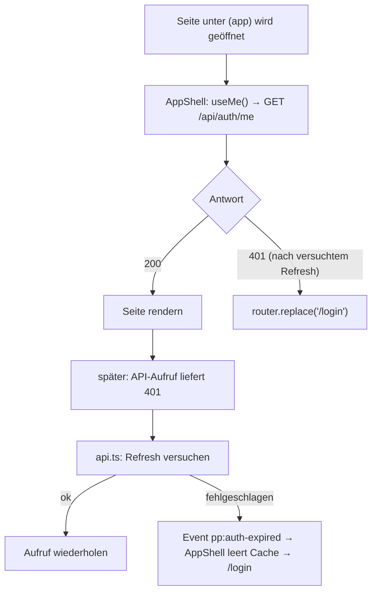

#### Bild hochladen und verwenden

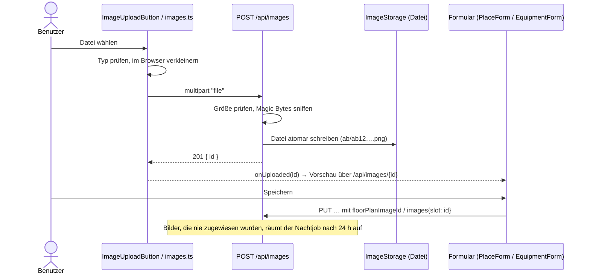

#### Place bearbeiten

1. `EditPlaceView` lädt den Ort (`usePlace`) und übergibt ihn an `PlaceForm`.
2. Der Benutzer fügt Marker hinzu (Add-Modus → Klick aufs Bild), verschiebt sie, wählt Equipment/Farbe.
3. „Speichern“ sendet `PUT /places/{id}` mit der **gesamten** Markerliste.
4. Der Server gleicht Marker per ID ab und schreibt den genauen Diff in den Verlauf.
5. Die Caches `folders` und `place/{id}` werden invalidiert, Navigation auf `/places/{id}`.

---

## 7. Tests und Qualitätssicherung

| Bereich | Befehl | Inhalt |
|---|---|---|
| Backend | `cd backend && ./mvnw verify` | Rund 240 Tests: Unit-Tests (Services mit Mockito, Filter, Storage, Diff-Logik, Entities) und Integrationstests gegen eine echte PostgreSQL via **Testcontainers** (Docker nötig). JaCoCo-Bericht unter `target/site/jacoco`. |
| Frontend | `cd frontend && npm test` | Rund 275 Vitest- und Testing-Library-Tests (API-Client inkl. CSRF/Refresh, Logger, Formulare, Editor, Admin-Oberflächen, Übersetzungen). `npm run test:coverage` für den Bericht. |
| Statisch | `npm run lint && npm run typecheck` | ESLint, `tsc --noEmit`. |

Backend-Tests liegen spiegelbildlich zu den Paketen in `src/test/java/app/partyplaner/…`. Besonders wichtig sind
`ApiIntegrationTest` (End-to-End über HTTP mit echter DB), `AuthServiceTest` (Login-Sperre, Rotation, Wiederverwendung), `PlaceDiffTest`/`PlaceMarkersTest`
(Verlaufslogik), `ImageStorageTest`/`ImageServiceSniffTest` (Pfad-Sicherheit, Magic Bytes), `RateLimitFilterTest`,
`CookieJwtAuthenticationFilterTest`, `RevokedSessionsTest`, `GuestControllerTest`, `InvitationServiceTest`, `ShareServiceTest`.
Hilfsklassen: `TestcontainersConfiguration`, `TestUsers`, `TestProps`.

Frontend: Testdateien liegen neben dem Code (`*.test.ts(x)`). `vitest.setup.ts` ergänzt, was jsdom fehlt (`<dialog>`-Verhalten, Pointer-Capture,
`matchMedia`, `PointerEvent`); `src/test/utils.tsx` und `mocks.ts` stellen Render-Helfer (Provider) und Mocks bereit. Routendateien unter `src/app` sind von der Coverage
ausgenommen, weil sie nur verdrahten.

Hinweis: Meldet Maven nach IDE-Builds „Unresolved compilation problem“, hilft `./mvnw clean verify`.

---

## 8. Sicherheitskonzept in einer Tabelle

| Bedrohung | Gegenmaßnahme |
|---|---|
| Passwort-Diebstahl aus der DB | Argon2id-Hashes |
| Brute-Force auf Login | Sperre nach 5 Fehlversuchen (15 min) + IP-Rate-Limit (10/min) |
| Konto-Enumeration | Einheitliche `INVALID_CREDENTIALS`-Antwort + Dummy-Hash für gleiche Antwortzeit |
| XSS stiehlt Tokens | Tokens nur in `HttpOnly`-Cookies; strenge CSP |
| CSRF | Double-Submit-Cookie (`XSRF-TOKEN` / `X-XSRF-TOKEN`) + `SameSite=Strict` |
| Gestohlenes Refresh-Token | Rotation + Familien-Widerruf bei Wiederverwendung; Tokens nur als SHA-256 gespeichert |
| Gesperrter Benutzer nutzt altes Token | `RevokedSessions` lehnt ältere Access-Tokens sofort ab |
| Zugriff auf fremde Daten | Alle Abfragen nach Besitzer gefiltert, sonst `404` |
| Gefälschte Bilder / Path-Traversal | Magic-Byte-Prüfung (PNG/JPEG/WebP), UUID-basierte Schlüssel, Pfad bleibt im Wurzelverzeichnis |
| Share-Link-Missbrauch | Widerruf wirkt sofort (Prüfung bei jeder Gast-Anfrage); Gast-Token nur für einen Ort und nur lesend |
| Einladungs-Link-Leak aus der DB | Nur der Hash wird gespeichert; Link wird einmal angezeigt; Zeilensperre gegen Doppel-Nutzung |
| Log-Forging | Steuerzeichen aus Client-Eingaben werden entfernt; Längen begrenzt |
| Aussperren aller Admins | Der letzte aktive Admin und das eigene Konto sind geschützt |
| Container-Ausbruch | Unprivilegierte Benutzer, `no-new-privileges`, `cap_drop: ALL`, Backend nicht exponiert |

---

## 9. Fehlersuche (Troubleshooting)

| Symptom | Ursache / Lösung |
|---|---|
| **Nach Registrierung/Login „bitte anmelden“** | `COOKIE_SECURE=true`, aber die Seite läuft über **http**. Browser verwerfen `Secure`-Cookies. Entweder HTTPS (Reverse-Proxy) einrichten oder zum reinen Testen `COOKIE_SECURE=false` setzen und `docker compose up -d --force-recreate backend` ausführen (ein einfaches `restart` liest die `.env` nicht neu). |
| Backend startet nicht, Meldung zu `JWT_SECRET` | Secret fehlt oder ist kürzer als 32 Zeichen. `openssl rand -base64 48` verwenden. |
| `docker compose up` bricht mit „set POSTGRES_PASSWORD …“ ab | `.env` fehlt oder Wert nicht gesetzt. |
| `403 FORBIDDEN` bei POST/PUT/DELETE | CSRF-Header fehlt oder passt nicht zum Cookie (z. B. Cookies blockiert). |
| `429 RATE_LIMITED` | Zu viele Login-/Register-/Refresh-Versuche pro Minute von einer IP. Kurz warten (`Retry-After`). Hinter einem Proxy muss `X-Forwarded-For` korrekt gesetzt werden. |
| Bilder fehlen nach Neustart | Volume `imagedata` nicht gemountet/geleert. Datenbank und Bildverzeichnis **immer gemeinsam** sichern. |
| `IMAGE_FILE_MISSING` im Log | Zeile in der DB existiert, Datei nicht mehr (z. B. Volume verloren) → Antwort `404`. |
| Alte DB nach Umbenennung | Standardname/-benutzer sind jetzt `partyplaner` (früher `partyplanner`). Entweder alte Werte in der `.env` setzen oder `docker compose down -v` (löscht Daten!). |
| Frontend zeigt „Etwas ist schiefgelaufen“ | Fehler wird als `RENDER_ERROR` im Live-Log protokolliert; dort (Einstellungen → Live-Log) nachsehen. Zu einer Serverzeile passt die `X-Request-Id`. |
| API-Fehler im Frontend-Container | Der Service muss `backend` heißen (Build-Argument `BACKEND_URL=http://backend:8080`). |
| Live-Log zeigt nichts | Level-Filter zu hoch oder Verbindung unterbrochen (Anzeige „verbunden“); EventSource verbindet sich selbst neu. |

---

## 10. Glossar

| Begriff | Erklärung |
|---|---|
| **JWT** | JSON Web Token: signiertes Token mit Benutzerdaten (hier HS256). Das Backend speichert Access-Tokens nicht. |
| **Access-Token** | Kurzlebiges (15 min) JWT im Cookie `pp_access`. |
| **Refresh-Token** | Langlebiges (14 d), zufälliges, **rotierendes** Token im Cookie `pp_refresh` zum Erneuern des Access-Tokens. |
| **Token-Familie** | Alle Refresh-Tokens, die aus einem einzigen Login hervorgehen. Wird bei Diebstahlverdacht gemeinsam widerrufen. |
| **CSRF** | Cross-Site Request Forgery – eine fremde Seite löst im Namen des Benutzers Aktionen aus. |
| **SSE** | Server-Sent Events: Der Server schiebt Ereignisse über eine offene HTTP-Verbindung an den Browser (Live-Log). |
| **MDC** | Mapped Diagnostic Context: threadgebundene Logging-Variablen (`requestId`, `user`). |
| **Flyway** | Werkzeug für versionierte Datenbank-Migrationen (`V1__…sql`). |
| **Testcontainers** | Startet für Tests echte Docker-Container (hier PostgreSQL). |
| **Standalone-Build** | Next.js-Ausgabe mit nur den nötigen Dateien zum Betrieb (`node server.js`). |
| **GHCR** | GitHub Container Registry, Ablageort der veröffentlichten Docker-Images. |
